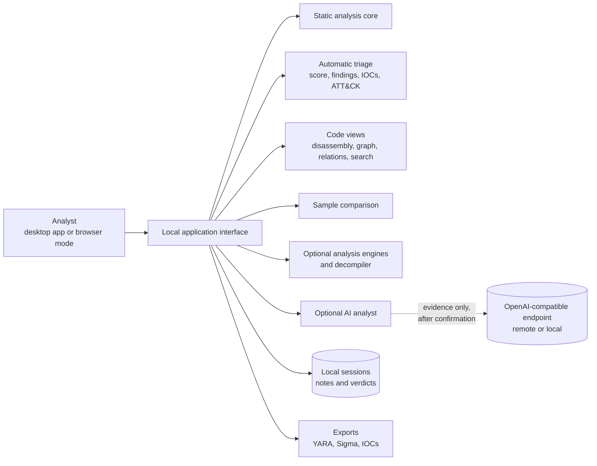
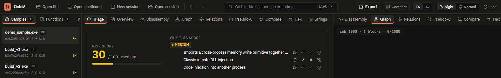
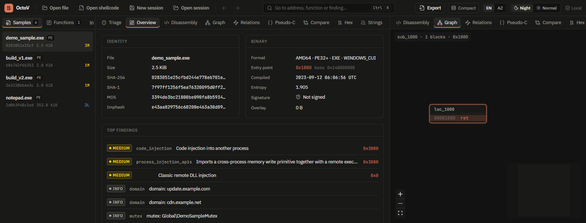
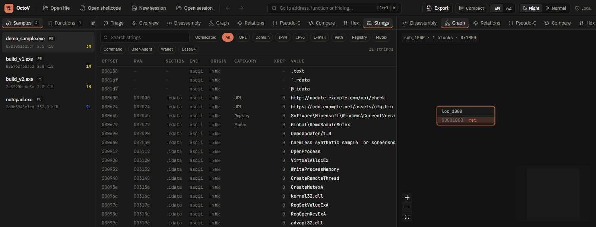
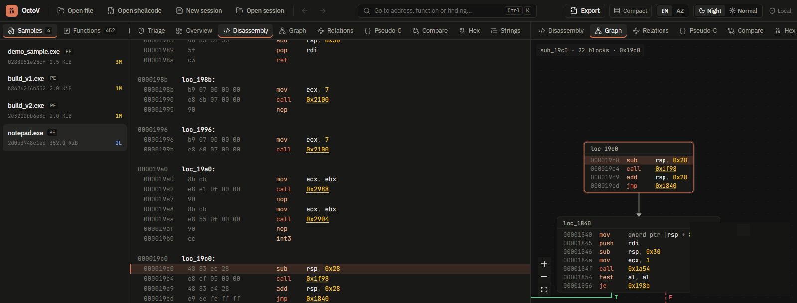
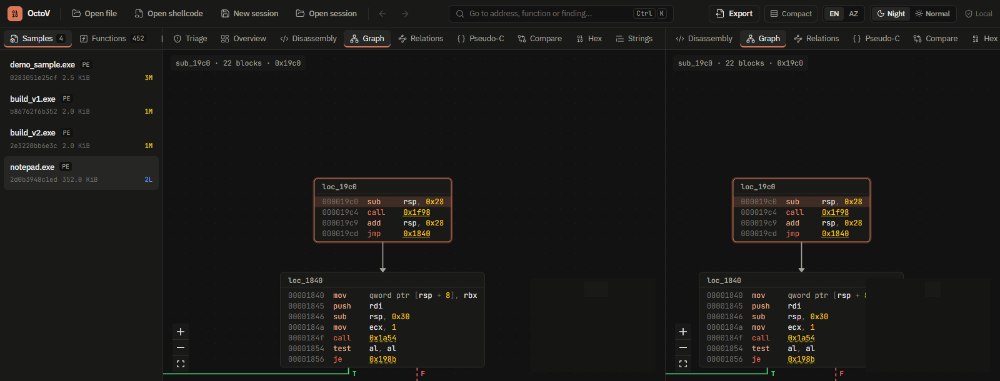
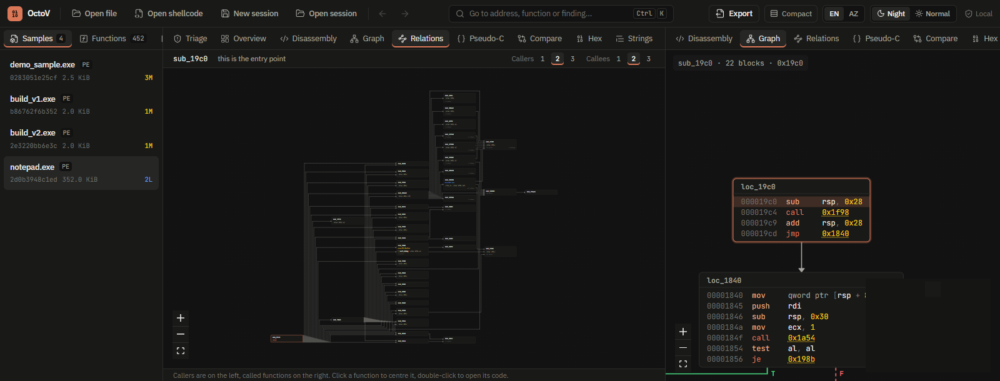
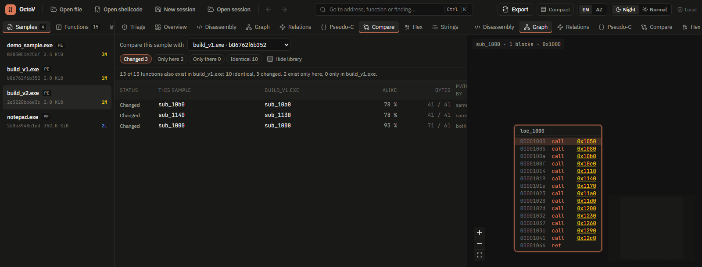
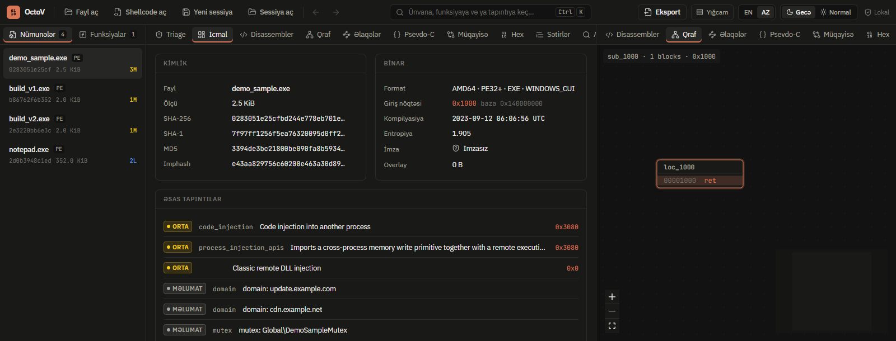

<h1 align="center">OctoV</h1>

<b>A Windows binary analysis workbench for defenders: explained, evidence-backed triage from first look to detection rule.</b>

  
  
  
  
  
  
  

<b>For SOC and DFIR teams, detection engineers, threat hunters and security training.</b>

---

## Overview

When a suspicious Windows executable lands on an analyst's desk, the questions are always the same. What does it do? How dangerous is it? What should we detect and block? Answering them usually means juggling several separate tools and reading raw disassembly, which takes time and expertise that many teams don't have. Sensitive samples often can't be uploaded to online services at all.

**OctoV** brings that work into one desktop workbench. Opening a file starts an automatic triage: a risk score, the findings behind it, extracted indicators and mapped adversary techniques. Every finding is explained in plain language, points to its exact evidence in the file, and suggests a next step, so beginners can follow the reasoning and experienced analysts can verify it quickly. From there the analyst can go as deep as needed (disassembly, control-flow graphs, call relations, decompiled code) and finish with ready-to-use detection content.

OctoV is **defensive only** and **fully local**: samples never leave the machine. An optional AI analyst can help explain a sample, but it only ever sees extracted evidence that the analyst has reviewed and confirmed. OctoV also ships with a **first-class Azerbaijani interface** alongside English.

## Key features

- **Instant triage on open.** A 0–100 risk score with every contributing finding listed, so analysts know within seconds where to look.
- **Explained, evidence-backed findings.** Each finding comes with a plain-language explanation, a suggested next step and its exact location in the file. Analysts can confirm a finding or mark it as false positive or benign, and the result updates.
- **Strings and IOC extraction.** URLs, domains, IPs, registry keys, mutexes, commands and more, categorised and searchable, including strings hidden from a simple scan. Export as CSV or JSON.
- **MITRE ATT&CK mapping.** Detected behaviour is linked to ATT&CK techniques.
- **Detection engineering output.** Generate YARA and Sigma rules from what was found.
- **Deep-dive code views.** Disassembly, control-flow graph, hex view and an optional decompiled pseudo-C view, all kept in sync.
- **Navigation built for large binaries.** A call-relations graph, byte/text/constant search, symbols and a file layout map stay fast even on files with tens of thousands of functions.
- **Sample comparison.** Compare two builds function by function: identical, changed (with similarity) or only in one. You can bring your names and notes over to the new version.
- **Library-function recognition.** Known runtime and library code is named and set aside, so attention goes to the sample's own code.
- **Optional AI analyst.** Evidence-only, shown and confirmed before every send, citations verified. Works with any OpenAI-compatible endpoint, including local models.
- **First-class Azerbaijani interface.** The full UI and all finding explanations in English and Azerbaijani, with night and normal display modes.
- **Fully local, private by design.** Samples never leave the machine, there is no telemetry, and files are analysed without ever being run.

## Architecture

Everything inside the workbench runs on the analyst's machine. The only optional outbound connection is the AI analyst, and only after the analyst confirms what will be sent.

## Tech stack

| Area | Technologies |
|---|---|
| Core | Python |
| User interface | React, TypeScript, Vite, Tailwind CSS, in a native desktop window (Edge WebView2) or a local browser mode |
| Performance | Optional Rust native core |
| Storage | Local, file-based sessions (SQLite) |
| Open-source integrations | Capstone (disassembly); optional: Ghidra (decompiler), capa, FLOSS |
| AI (optional) | Any OpenAI-compatible endpoint, including local models |
| Quality | pytest, mypy (strict), ruff, Vitest, GitHub Actions CI on Windows |

## Measured results

| Metric | Result |
|---|---|
| Native core vs. Python path | ~5× faster, less than half the memory |
| False-positive check on clean files | ~99% of ~4,370 Windows 11 system files scored low risk |
| Two-sample comparison | ~3 s |

> Measured by the developer during internal testing. Not an independent benchmark.

## Screenshots

| | |
|---|---|
|  |  |
| **Triage:** risk score and the findings behind it | **Overview:** file identity, binary details, top findings |
|  |  |
| **Strings and IOCs:** categorised, searchable, cross-referenced | **Disassembly:** linked to the graph view |
|  |  |
| **Control-flow graph:** side by side with the code | **Relations:** callers and callees around a function |
|  |  |
| **Compare:** two builds, function by function | **First-class Azerbaijani interface** |

Screenshots show synthetic, harmless test files built for this purpose and a stock Windows system binary (Notepad). No real malware is involved.

**Demo video:** coming soon

## My role

**Sole developer.** I designed and built OctoV on my own: product direction, architecture, implementation, testing and UI/UX.

## Status & roadmap

**Status:** in active development · pre-release.

**Planned:**
- Dynamic analysis
- HTML/PDF reports
- STIX 2.1 / MISP / Snort export
- Guided analysis workflows
- Plugin API
- PDB (debug symbol) support

## Source code

Private — commercial product. Access can be provided on request for interviews.

**Contact:** Fakhraddin Mashadizada, Information Security student (SOC / Security Engineering)
- GitHub: [github.com/m3dvsa-35](https://github.com/m3dvsa-35)
- LinkedIn: [linkedin.com/in/fakhraddin-m-567201318](https://www.linkedin.com/in/fakhraddin-m-567201318)

## License

© 2026 Fakhraddin Mashadizada. All rights reserved.

This repository contains documentation and screenshots only. No source code is included, and no license is granted to use, copy or redistribute any part of the product.
